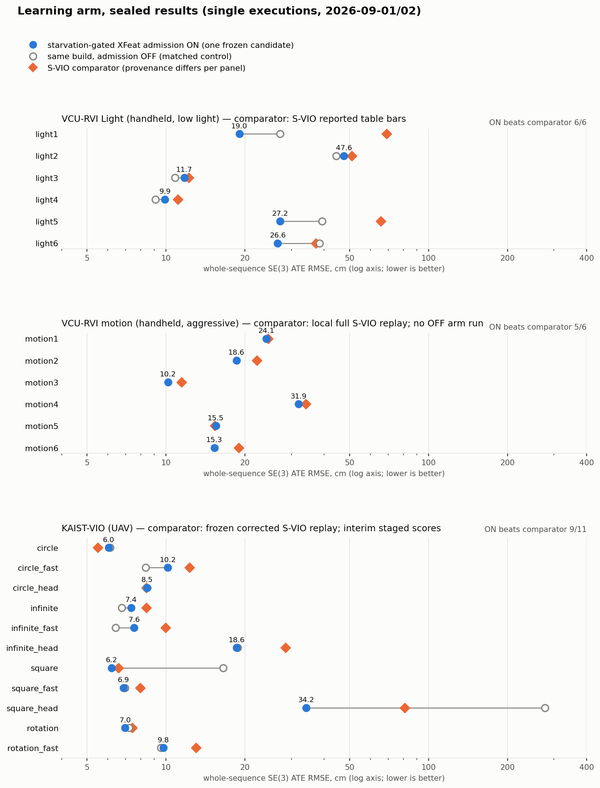

# xfeat-admission-vio

**Learned identity supply for classical visual-inertial front ends — a sidecar ABI
any KLT tracker can consume, a reference integration into an RGB-D VIO, and a path
from desktop replay to the RK3588 NPU.**

Classical VIO front ends die in one specific way: the tracker starves, the refill
detector hands the optimizer texture-less garbage, and the sliding window folds the
damage into its prior. This project puts a small pretrained network (XFeat) in
exactly one seat — **the supplier of new-track candidates, only while the tracker
is starving** — and leaves the estimator's mathematics alone. The network proposes
identity; it never proposes motion.

The goal is a one-stop learned front-end kit: pluggable feature backbones behind
one binary sidecar format, gate policies that are identity-blind and auditable,
adapters for the common open-source estimators, and device receipts for embedded
NPUs — so that "add a learned detector to my VIO" becomes a configuration change
with a reproducible ledger, not a research project.

## Where it stands: release 1.0

* **One frozen candidate, two datasets, three sequence families.** Starvation-gated
  admission wins eleven of twelve VCU-RVI handheld sequences against S-VIO and nine of
  eleven KAIST-VIO UAV sequences against a corrected S-VIO replay, with no
  per-sequence switch. Learning is credited only where the matched control says so:
  three of six on Light, six of eleven on KAIST, including the two rows where the
  control collapses and the gated build holds. Full tables and provenance:
  [`docs/LEDGER.md`](docs/LEDGER.md).
* **The mechanism fits on one page:** [`docs/MECHANISM.md`](docs/MECHANISM.md).
  Two bits of state, one budget-relative threshold, an external health signal.
* **Reproducible to the byte at the source level.** The gate-patched tracker hashes
  to the values frozen before the held-out sequences were opened
  (`PROVENANCE.json`); every stage under `experiments/` carries its pre-execution
  contract and post-execution receipts.
* **Deployment split proven at the compiler.** The fixed-shape XFeat backbone
  compiles wholly to RK3588 NPU compute operators (`deploy/rknn/`); the sparse tail,
  matching and the gate stay on CPU.



## Layout

```
svio/ camera_models_in/ config/ launch/   the S-VIO fork itself, at the repository root as upstream laid it out, with the XFeat sidecar reader, three front-end modes, and the gate
patches/                the three diffs that turn upstream S-VIO into this estimator, in order
sidecar/                XFSIDE01 writer (xfs_materialize.py), header verifier, pinned sparse-XFeat implementation
models/                 fixed-shape XFeat ONNX export (Apache-2.0 derivative) and its export receipt
deploy/rknn/            RKNN-Toolkit2 conversion tool and same-run receipts (the .rknn bytes are not redistributed)
tools/scoring/          the pinned scorer and normalizer used for every number in the ledger
experiments/            stage-by-stage contracts, configs, receipts, trajectories, telemetry
docs/                   mechanism, ledger, reproduction recipe, figures
```

## Quick start (replay)

```bash
# 1. sidecar for one bag (ROS 1 .bag or ROS 2 directory), 640x480 color topic
python3 sidecar/xfs_materialize.py --bag /data/vcu_rvi/light1_ros2 \
    --topic /d400/color/image --out /scratch/light1.xfs
python3 sidecar/verify_xfs_header.py /scratch/light1.xfs

# 2. build the estimator (ROS Noetic, OpenCV 4.2, Ceres 1.14) — see docs/REPRODUCE.md for the container recipe
# 3. run with the sidecar (ON) or without it (matched OFF)
SVIO_XFEAT_XFS=/scratch/light1.xfs SVIO_XFEAT_MODE=admission \
    rosrun svio svio_syn_node _config_file:=experiments/02_vcu_motion_full_line/config_full_line.yaml
```

The full recipe, including the exact container, the scorer invocation and the
verification record of this repository's own rebuild, is in
[`docs/REPRODUCE.md`](docs/REPRODUCE.md).

## Version line

| Version | What it is |
|---|---|
| **1.0** | final code release: frozen candidate, sidecar tooling, sealed VCU + KAIST ledger, RKNN compile receipts, byte-identical rebuild verification |
| 1.x | on-device receipts from the RK3588S campaign as they are measured; no code change planned |

See [`ROADMAP.md`](ROADMAP.md) and [`CHANGELOG.md`](CHANGELOG.md).

## License and attribution

GPL-3.0 (the estimator is a derivative of S-VIO). XFeat is Apache-2.0. Provenance,
third-party notices and what is deliberately not redistributed:
[`NOTICE.md`](NOTICE.md).

If you build on the gate or the sidecar format, please cite S-VIO (Gu and Meng,
RA-L 2023) and XFeat (Potje et al., CVPR 2024) alongside this repository.
