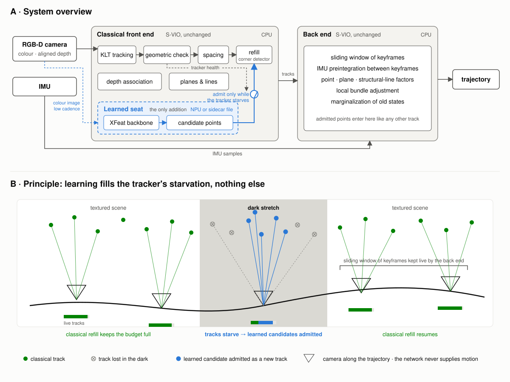
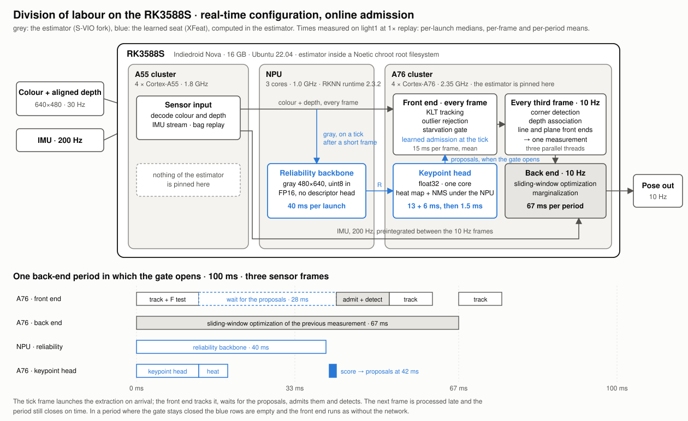
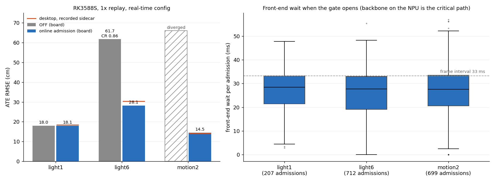

# xfeat-admission-vio

**Learned identity supply for classical visual-inertial front ends — one proposal
interface any KLT tracker can consume (a recorded sidecar, or inference inside the
estimator), a reference integration into an RGB-D VIO, and real-time operation on the
RK3588 NPU.**

Classical VIO front ends die in one specific way: the tracker starves, the refill
detector hands the optimizer texture-less garbage, and the sliding window folds the
damage into its prior. This fork of [S-VIO](https://github.com/oranfire/SVIO) puts a
small pretrained network (XFeat) in exactly one seat — **the supplier of new-track
candidates, only while the tracker is starving** — and leaves the estimator's
mathematics alone. The network proposes identity; it never proposes motion.

The goal is a one-stop learned front-end kit: pluggable feature backbones behind
one proposal interface, gate policies that are identity-blind and auditable,
adapters for the common open-source estimators, and device receipts for embedded
NPUs — so that "add a learned detector to my VIO" becomes a configuration change
with a reproducible ledger, not a research project.



*A: what is added to S-VIO and where. B: along one trajectory, classical tracks (green)
feed the tracker while the scene is textured; in a dark stretch they starve, and only
there the network's candidates (blue) are admitted as new tracks. Source text of the
figure: `docs/figures/overview_source.txt`.*

## Results on VCU-RVI, the handheld benchmark S-VIO was built for

Whole-sequence SE(3) ATE RMSE in centimetres, no scale, start offset 0, from the
pinned scorer in `tools/scoring/`. One configuration for all twelve sequences; no
per-sequence switch. Every row is a single execution. **ON** is this fork with the
XFeat sidecar and the starvation gate; **OFF** is the same binary and configuration
with the sidecar absent, the only like-for-like control.

**Light 1–6** (low light). The S-VIO column is the value reported in the S-VIO
paper, rounded as published; light1/3/5 informed the gate threshold, light2/4/6 were
locked before the candidate ran.

| Sequence | ON | OFF | S-VIO (reported) |
|---|---:|---:|---:|
| light1 | 19.02 | 27.20 | 69.3 |
| light2 | 47.57 | 44.55 | 51.1 |
| light3 | 11.74 | 10.84 | 12.2 |
| light4 | 9.91 | 9.12 | 11.1 |
| light5 | 27.19 | 39.28 | 65.7 |
| light6 | 26.64 | 38.52 | 37.3 |
| mean | 23.68 | 28.25 | 41.12 |

**motion 1–6** (aggressive handheld motion). The S-VIO column is a local replay of
the unmodified upstream estimator under its own configuration, scored identically.

| Sequence | ON | OFF | S-VIO (local replay) |
|---|---:|---:|---:|
| motion1 | 24.10 | 23.96 | 24.47 |
| motion2 | 18.55 | 20.29 | 22.22 |
| motion3 | 10.18 | 10.23 | 11.46 |
| motion4 | 31.94 | 29.79 | 34.09 |
| motion5 | 15.48 | 14.24 | 15.34 |
| motion6 | 15.28 | 18.24 | 18.91 |
| mean | 19.25 | 19.46 | 21.08 |

How to read the two tables:

* Against S-VIO, the one frozen candidate wins eleven of the twelve sequences; the only
  loss is motion5.
* Against its own OFF control, learned admission helps where the tracker starves: the
  three dark Light sequences (light1, light5, light6) and three of the six motion sequences (motion2, motion3,
  motion6). Where the tracker is healthy the gate rarely opens and the two arms land
  within a few centimetres of each other, either way.
* OFF alone already beats the reported S-VIO bars on five of six Light sequences and
  the upstream replay on all six motion sequences. That gap belongs to reproducibility
  work on S-VIO itself, not to learning: an
  undefined-behaviour fix in depth association, dead configuration keys made
  explicit, and one denser feature spacing. `docs/LEDGER.md` separates the two.

The stage-by-stage record, including the motion4 design ladder that selected
admission-only over descriptor-identity and hybrid modes, is in
[`docs/LEDGER.md`](docs/LEDGER.md); every stage under `experiments/` carries its
pre-execution contract and post-execution receipts.

## Mechanism

Two bits of state, one budget-relative threshold, an external health signal: on every
frame the tracker counts its post-F-RANSAC survivors; after two consecutive frames
below 120 of the 150-track budget, the next 10 Hz XFeat tick may admit new-track
candidates, score-ordered, before the ordinary Shi-Tomasi refill. Nothing else in
S-VIO changes: not the identities, not the keyframe logic, not the backend. The
candidates come from a recorded sidecar or, since 1.5, from the estimator itself,
computed online on exactly the ticks where the gate can open.
[`docs/MECHANISM.md`](docs/MECHANISM.md) has the full page, the three front-end
modes, both proposal sources and the XFSIDE01 sidecar format.

## Reproducible

Every number comes from the pinned scorer in `tools/scoring/`, and
[`docs/REPRODUCE.md`](docs/REPRODUCE.md) rebuilds the frozen candidate in a container
and replays it. The deployment paths added since, the back-end cadence and online
admission, are off unless selected and leave the frozen behavior intact (receipts in
`experiments/`).

## Layout

```
svio/ camera_models_in/ config/ launch/   the S-VIO fork itself, at the repository root as upstream laid it out, with the gate, three front-end modes and both proposal sources (sidecar, online)
patches/                the five diffs that turn upstream S-VIO into this estimator, in order (04: the back-end cadence of 1.4; 05: online admission of 1.5; both off by default)
sidecar/                XFSIDE01 writer (xfs_materialize.py), header verifier, pinned sparse-XFeat implementation
models/                 fixed-shape XFeat ONNX export (Apache-2.0 derivative) and its export receipt; models/online/: the reliability model and keypoint-head weights of the online path
deploy/rknn/            RKNN-Toolkit2 conversion tool and same-run receipts (the .rknn bytes are not redistributed)
tools/scoring/          the pinned scorer and normalizer used for every number in the ledger
experiments/            stage-by-stage contracts, configs, receipts, trajectories, telemetry, board receipts
deploy/board/           aarch64 build recipe, chroot launcher, replay runner and NPU sidecar materializer for the RK3588S
deploy/online/          online admission: model export, RKNN conversion, parity and deadline tools
docs/                   mechanism, ledger, reproduction recipe
```

## Quick start (replay)

```bash
# 1. sidecar for one bag (ROS 1 .bag or ROS 2 directory), 640x480 color topic
python3 sidecar/xfs_materialize.py --bag /data/vcu_rvi/light1_ros2 \
    --topic /d400/color/image --out /scratch/light1.xfs
python3 sidecar/verify_xfs_header.py /scratch/light1.xfs

# 2. build the estimator (ROS Noetic, OpenCV 4.2, Ceres 1.14) — see docs/REPRODUCE.md for the container recipe
# 3. run with the sidecar (ON) or without it (matched OFF)
SVIO_XFEAT_XFS=/scratch/light1.xfs SVIO_XFEAT_MODE=admission \
    rosrun svio svio_syn_node _config_file:=experiments/02_vcu_motion_full_line/config_full_line.yaml

# or no sidecar at all: the estimator computes its proposals online
# (build with -DSVIO_XFEAT_ONNXRUNTIME_ROOT=... on a desktop, -DSVIO_XFEAT_RKNN=ON on an RK3588)
SVIO_XFEAT_MODE=admission SVIO_XFEAT_ONLINE_MODEL=models/online/reliability_gray.onnx \
SVIO_XFEAT_ONLINE_KHEAD=models/online/keypoint_head_fp32.bin \
    rosrun svio svio_syn_node _config_file:=experiments/02_vcu_motion_full_line/config_full_line.yaml
```

## On the RK3588S

The whole estimator runs in real time on an RK3588S (Indiedroid Nova, 16 GB). It is
an aarch64 build inside an Ubuntu 20.04 + ROS Noetic root filesystem entered with
`chroot`, compiled natively for the A76 cores ([`deploy/board/`](deploy/board/README.md)).
The front end runs on every frame: KLT, outlier rejection, the starvation gate and the
learned admission. Corner detection, depth association, the line and plane front ends
and the measurement run at 10 Hz (`backend_freq_gate: 1`,
`experiments/12_rk3588s_realtime_20260903/config_realtime.yaml`).

The estimator computes its own proposals. Admission reads (x, y, score), and
score = K × R: the keypoint branch's heat map times the backbone's reliability. A
decision experiment on all twelve sequences showed that both factors must come from
the current frame; K alone and an R one tick old both lose the gains. So on a tick
that follows a short frame, the reliability backbone starts on the NPU as the frame
arrives. Meanwhile the keypoint branch and its heat map run on one A76 core in
float32. The front end takes the proposals when the gate opens; a healthy run never
touches the NPU.



Single runs at 1× replay, ATE RMSE in cm:

| RK3588S, 1× replay | OFF | online admission | desktop, recorded sidecar |
|---|---:|---:|---:|
| light1 | 17.98 | 18.06 | 18.41 |
| light6 | 61.73 (CR 0.86) | **28.13** | 30.37 |
| motion2 | diverged | **14.50** | 14.16 |



All three replays finish with nothing left to catch up, light6 with the gate open on
712 of its 1,041 ticks. When the gate opens, the front end waits a median 28 ms
(p95 40 ms) for the proposals. The backbone, about 40 ms on the three NPU cores, is the
whole critical path. On the desktop, all twelve sequences, online admission and
recorded-sidecar replay agree to within the estimator's run-to-run variation. Receipt:
[`experiments/13_online_admission_20261017/ONLINE_RECEIPT.md`](experiments/13_online_admission_20261017/ONLINE_RECEIPT.md);
build and run: [`deploy/online/README.md`](deploy/online/README.md).


## Version line

| Version | What it is |
|---|---|
| 1.0 | the mechanism: frozen candidate, sidecar tooling, VCU ledger, rebuild verification |
| 1.1 | RK3588S on-device receipts: NPU latency, memory, conformance against ONNX |
| 1.2 | matched-OFF control on all twelve VCU sequences |
| 1.3 | the estimator end to end on the RK3588S |
| 1.4 | real time on the RK3588S: front end at sensor rate, back end at 10 Hz |
| **1.5** | online admission: proposals computed in the estimator, only where the gate can open; light6 and motion2 rescued on the board |
| 1.x | a live camera on the board, a faster NPU backbone (mixed precision, INT8), per-layer NPU profiling, more backbones behind the online interface |

See [`ROADMAP.md`](ROADMAP.md) and [`CHANGELOG.md`](CHANGELOG.md).

## License and attribution

GPL-3.0 (the estimator is a derivative of S-VIO). XFeat is Apache-2.0. Provenance,
third-party notices and what is deliberately not redistributed:
[`NOTICE.md`](NOTICE.md).

If you build on the gate or the proposal interface, please cite S-VIO (Gu and Meng,
RA-L 2023) and XFeat (Potje et al., CVPR 2024) alongside this repository.
