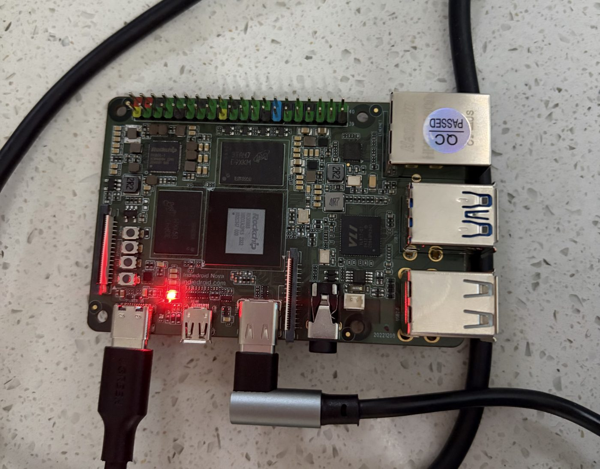

# xfeat-admission-vio

**Learned identity supply for classical visual-inertial front ends — a sidecar ABI
any KLT tracker can consume, a reference integration into an RGB-D VIO, and a path
from desktop replay to the RK3588 NPU.**

Classical VIO front ends die in one specific way: the tracker starves, the refill
detector hands the optimizer texture-less garbage, and the sliding window folds the
damage into its prior. This fork of [S-VIO](https://github.com/oranfire/SVIO) puts a
small pretrained network (XFeat) in exactly one seat — **the supplier of new-track
candidates, only while the tracker is starving** — and leaves the estimator's
mathematics alone. The network proposes identity; it never proposes motion.

The goal is a one-stop learned front-end kit: pluggable feature backbones behind
one binary sidecar format, gate policies that are identity-blind and auditable,
adapters for the common open-source estimators, and device receipts for embedded
NPUs — so that "add a learned detector to my VIO" becomes a configuration change
with a reproducible ledger, not a research project.

## Results on VCU-RVI, the handheld benchmark S-VIO was built for

Whole-sequence SE(3) ATE RMSE in centimetres, no scale, start offset 0, from the
pinned scorer in `tools/scoring/`. One configuration for all twelve sequences; no
per-sequence switch. Every row is a single execution. **ON** is this fork with the
XFeat sidecar and the starvation gate; **OFF** is the same binary and configuration
with the sidecar absent, the only like-for-like control.

**Light 1–6** (low light). The S-VIO column is the value reported in the S-VIO
paper, rounded as published; light1/3/5 informed the gate threshold, light2/4/6 were
locked before the candidate ran.

| Sequence | ON | OFF | S-VIO (reported) |
|---|---:|---:|---:|
| light1 | 19.02 | 27.20 | 69.3 |
| light2 | 47.57 | 44.55 | 51.1 |
| light3 | 11.74 | 10.84 | 12.2 |
| light4 | 9.91 | 9.12 | 11.1 |
| light5 | 27.19 | 39.28 | 65.7 |
| light6 | 26.64 | 38.52 | 37.3 |
| mean | 23.68 | 28.25 | 41.12 |

**motion 1–6** (aggressive handheld motion). The S-VIO column is a local replay of
the unmodified upstream estimator under its own configuration, scored identically.
The OFF column was produced on 2026-09-03 with the rebuilt binary that is
byte-identical to the frozen candidate.

| Sequence | ON | OFF | S-VIO (local replay) |
|---|---:|---:|---:|
| motion1 | 24.10 | 23.96 | 24.47 |
| motion2 | 18.55 | 20.29 | 22.22 |
| motion3 | 10.18 | 10.23 | 11.46 |
| motion4 | 31.94 | 29.79 | 34.09 |
| motion5 | 15.48 | 14.24 | 15.34 |
| motion6 | 15.28 | 18.24 | 18.91 |
| mean | 19.25 | 19.46 | 21.08 |

How to read the two tables:

* Against S-VIO, the one frozen candidate wins eleven of the twelve sequences; the only
  loss is motion5.
* Against its own OFF control, learned admission helps where the tracker starves: the
  three dark Light sequences (light1, light5, light6) and three of the six motion sequences (motion2, motion3,
  motion6). Where the tracker is healthy the gate rarely opens and the two arms land
  within a few centimetres of each other, either way.
* OFF alone already beats the reported S-VIO bars on five of six Light sequences and
  the upstream replay on all six motion sequences. That gap belongs to reproducibility
  work on S-VIO itself, not to learning: an
  undefined-behaviour fix in depth association, dead configuration keys made
  explicit, and one denser feature spacing. `docs/LEDGER.md` separates the two.

The stage-by-stage record, including the motion4 design ladder that selected
admission-only over descriptor-identity and hybrid modes, is in
[`docs/LEDGER.md`](docs/LEDGER.md); every stage under `experiments/` carries its
pre-execution contract and post-execution receipts.

## Mechanism

Two bits of state, one budget-relative threshold, an external health signal: on every
frame the tracker counts its post-F-RANSAC survivors; after two consecutive frames
below 120 of the 150-track budget, the next 10 Hz XFeat tick may admit new-track
candidates, score-ordered, before the ordinary Shi-Tomasi refill. Nothing else in
S-VIO changes: not the identities, not the keyframe logic, not the backend.
[`docs/MECHANISM.md`](docs/MECHANISM.md) has the full page, the three front-end
modes and the XFSIDE01 sidecar format.

## Reproducible to the byte

The gate-patched tracker hashes to the values frozen before the held-out sequences
were opened, and a rebuild in the pinned container reproduces the frozen candidate
binaries byte for byte; a light1 replay of both arms agrees with the sealed ATE
(`docs/REPRODUCE.md`, `experiments/08_rebuild_verification_20260902/`).

## Layout

```
svio/ camera_models_in/ config/ launch/   the S-VIO fork itself, at the repository root as upstream laid it out, with the XFeat sidecar reader, three front-end modes, and the gate
patches/                the three diffs that turn upstream S-VIO into this estimator, in order
sidecar/                XFSIDE01 writer (xfs_materialize.py), header verifier, pinned sparse-XFeat implementation
models/                 fixed-shape XFeat ONNX export (Apache-2.0 derivative) and its export receipt
deploy/rknn/            RKNN-Toolkit2 conversion tool and same-run receipts (the .rknn bytes are not redistributed)
tools/scoring/          the pinned scorer and normalizer used for every number in the ledger
experiments/            stage-by-stage contracts, configs, receipts, trajectories, telemetry, board receipts
docs/                   mechanism, ledger, reproduction recipe
```

## Quick start (replay)

```bash
# 1. sidecar for one bag (ROS 1 .bag or ROS 2 directory), 640x480 color topic
python3 sidecar/xfs_materialize.py --bag /data/vcu_rvi/light1_ros2 \
    --topic /d400/color/image --out /scratch/light1.xfs
python3 sidecar/verify_xfs_header.py /scratch/light1.xfs

# 2. build the estimator (ROS Noetic, OpenCV 4.2, Ceres 1.14) — see docs/REPRODUCE.md for the container recipe
# 3. run with the sidecar (ON) or without it (matched OFF)
SVIO_XFEAT_XFS=/scratch/light1.xfs SVIO_XFEAT_MODE=admission \
    rosrun svio svio_syn_node _config_file:=experiments/02_vcu_motion_full_line/config_full_line.yaml
```

## On the RK3588S

The pinned FP16 backbone runs on an RK3588S (Indiedroid Nova, 16 GB) through the
Rockchip 2.3.2 runtime; the CPU sparse tail runs on the A76 cores. Milliseconds per
frame, 200 timed calls per input case:

| Stage | median | p90 | p99 |
|---|---:|---:|---:|
| XFeat backbone, NPU, three cores | 64.1 | 69.7 | 76.5 |
| XFeat backbone, NPU, one core | 67.7 | 75.4 | 79.2 |
| sparse tail (NMS, top-500, descriptor sampling), CPU | 19.0 | 19.1 | — |
| mutual-nearest-neighbour match, 500 × 500, CPU | 1.1 | 1.1 | — |

Real-frame outputs reproduce the ONNX backbone through the whole sparse tail
(500 of 500 keypoints, 0.996 within 1 px, descriptor cosine median 0.99999). The
frozen synthetic-pattern gate and the sandbox's 50 ms p99 gate both fail on this
board and its 0.7.2 NPU driver; the receipt says so in full:
[`experiments/09_rk3588s_board_20260903/BOARD_RECEIPT.md`](experiments/09_rk3588s_board_20260903/BOARD_RECEIPT.md).



## Version line

| Version | What it is |
|---|---|
| 1.0 | final code release: frozen candidate, sidecar tooling, sealed VCU ledger, RKNN compile receipts, byte-identical rebuild verification |
| 1.1 | RK3588S on-device receipts: identity, NPU latency per core mask, CPU sparse-tail latency, memory, conformance against the ONNX reference |
| **1.2** | matched-OFF control completed on all twelve VCU sequences with the rebuilt binary; README tables replace the chart |
| 1.x | further device receipts (C++ runtime path, driver upgrade, on-board end-to-end replay); no estimator code change planned |

See [`ROADMAP.md`](ROADMAP.md) and [`CHANGELOG.md`](CHANGELOG.md).

## License and attribution

GPL-3.0 (the estimator is a derivative of S-VIO). XFeat is Apache-2.0. Provenance,
third-party notices and what is deliberately not redistributed:
[`NOTICE.md`](NOTICE.md).

If you build on the gate or the sidecar format, please cite S-VIO (Gu and Meng,
RA-L 2023) and XFeat (Potje et al., CVPR 2024) alongside this repository.
